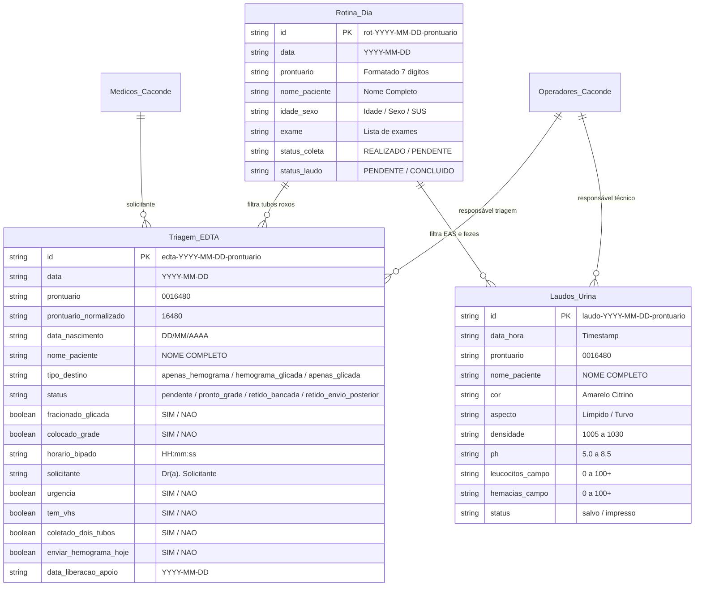
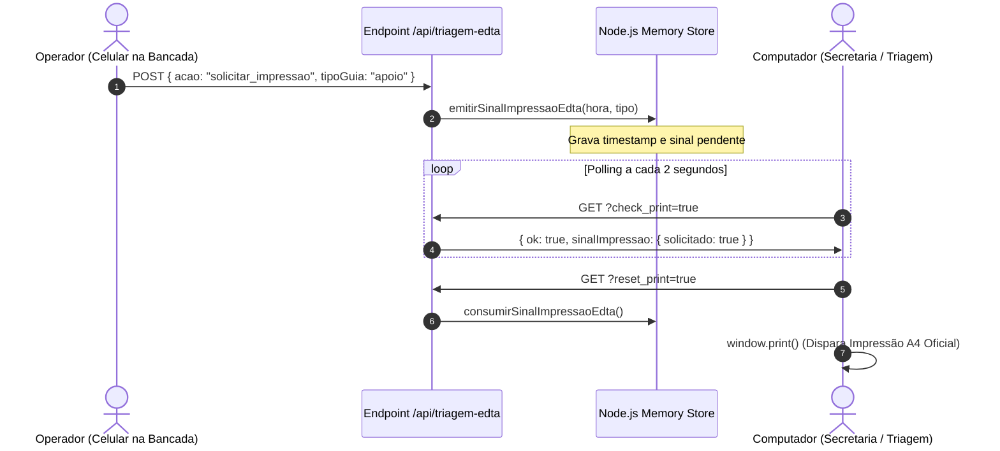

# BancadaLab SUS • Regras de Banco de Dados via Google Sheets por Setores

> [!abstract] Propósito Deste Documento
> Este documento detalha minuciosamente todas as **regras de negócio, funções de persistência, validações e comportamentos transacionais** implementados no código (`src/lib/googleSheets.ts`, `src/lib/extratorBancada.ts`, etc.) para substituir um banco de dados relacional tradicional (SQL) por uma arquitetura serverless baseada em **Google Sheets API v4 + Cache em Memória + Fallback Offline em Disco**.

---

## 🏛️ 1. Arquitetura Geral do "Banco de Dados em Planilhas"

O sistema opera com uma planilha mestre no Google Drive institucional (ID configurado nas variáveis de ambiente), dividida em **5 abas relacionais**. 



---

## 📥 2. Setor: Ingestão Geral & Recepção (`Rotina_Dia`)

A aba **`Rotina_Dia`** atua como a tabela central de ordens de serviço importadas diariamente dos relatórios brutos do **ConectaSUS / PSO**.

### 2.1 Esquema da Tabela
| Coluna | Campo | Tipo | Descrição / Regra |
| :---: | :--- | :---: | :--- |
| **A** | `id` | `VARCHAR(60)` | Chave primária única: `rot-{data}-{prontuario_limpo}`. |
| **B** | `data` | `DATE (ISO)` | Data do atendimento formatada estritamente em `YYYY-MM-DD`. |
| **C** | `prontuario` | `VARCHAR(20)` | Prontuário do paciente com zeros à esquerda preservados (ex: `0016480`). |
| **D** | `nome_paciente` | `VARCHAR(150)`| Nome em caixa alta sem caracteres corrompidos. |
| **E** | `idade_sexo` | `VARCHAR(30)` | Informação demográfica ou flag `SUS`. |
| **F** | `exame` | `TEXT` | Relação dos exames solicitados na guia (ex: `URINA I`, `HEMOGRAMA`). |
| **G** | `status_coleta` | `ENUM` | `REALIZADO` ou `PENDENTE` (filtrado no extrator). |
| **H** | `status_laudo` | `ENUM` | `PENDENTE`, `DIGITADO`, `CONCLUIDO` ou `CANCELADO`. |

### 2.2 Funções e Regras de Negócio do Setor (`salvarRotinaDia` / `listarRotinaDia`)
1. **Deduplicação Inteligente (Upsert):**
   - Ao importar uma nova planilha, o sistema pesquisa no Sheets pela chave composta `${data}_${prontuario}`.
   - **Regra de Ouro:** Se o paciente já existe no banco e já possui `status_laudo === "DIGITADO"` ou `"CONCLUIDO"`, o novo upload **jamais regride o status para pendente**.
2. **Preservação Histórica Multi-Dia:**
   - O sistema nunca executa `clear()` indiscriminado na planilha.
   - Registros de datas passadas (ontem, semana passada) são identificados via memória, unidos aos novos registros do dia e reescritos de forma consolidada.
3. **Extração de Flags por Expressão Regular:**
   - A função `aplicarFlagsExamesNoItem()` inspeciona o campo textual `exame` e popula dinamicamente booleans no frontend:
     - `tem_urina`: detecta `URINA I`, `EAS`, `SEDIMENTOSCOPIA`.
     - `tem_fezes`: detecta `PARASITOLOGICO`, `EPF`, `SANGUE OCULTO`.
     - `tem_vdrl`: detecta `VDRL`, `SOROLOGIA SIFILIS`.
     - `tem_dengue`: detecta `TESTE RAPIDO DENGUE`, `NS1`, `IGG`, `IGM`.
     - `tem_hemo`: detecta `HEMOGRAMA`, `SERIE VERMELHA`.
     - `tem_glicada`: detecta `HEMOGLOBINA GLICADA`, `HBA1C`.

---

## 🩸 3. Setor: Triagem Hematológica & Tubos EDTA (`Triagem_EDTA`)

A aba **`Triagem_EDTA`** gerencia o fluxo operacional de maior complexidade do laboratório: a triagem física dos tubos com tampa roxa (EDTA).

### 3.1 Esquema da Tabela
| Coluna | Campo | Tipo | Descrição / Regra |
| :---: | :--- | :---: | :--- |
| **A** | `id` | `VARCHAR(60)` | Chave primária: `EDTA-{data}-{prontuario_normalizado}`. |
| **B** | `data` | `DATE (ISO)` | Data da rotina laboratorial (`YYYY-MM-DD`). |
| **C** | `prontuario` | `VARCHAR(20)` | Prontuário formal (ex: `0007674`). |
| **D** | `prontuario_normalizado`| `VARCHAR(20)` | Prontuário sem zeros à esquerda (ex: `7674`). Usado para indexação rápida. |
| **E** | `data_nascimento` | `VARCHAR(10)` | Data no padrão brasileiro `DD/MM/AAAA`. |
| **F** | `nome_paciente` | `VARCHAR(150)`| Nome completo em maiúsculas. |
| **G** | `tipo_destino` | `ENUM` | `apenas_hemograma`, `hemograma_glicada` ou `apenas_glicada`. |
| **H** | `status` | `ENUM` | `pendente`, `pronto_grade`, `retido_bancada`, `retido_envio_posterior`. |
| **I** | `fracionado_glicada` | `BOOLEAN` | `SIM` ou `NAO` (se a alíquota de 500µL foi separada). |
| **J** | `colocado_grade` | `BOOLEAN` | `SIM` ou `NAO` (se o tubo físico entrou na grade de transporte). |
| **K** | `horario_bipado` | `TIME` | Horário exato da bipagem/conferência (`HH:mm:ss`). |
| **L** | `exames` | `TEXT` | Exames originais concatenados com ` + `. |
| **M** | `solicitante` | `VARCHAR(100)`| Médico solicitante (capturado via OCR ou editado). |
| **N** | `urgencia` | `BOOLEAN` | `SIM` ou `NAO` (prioridade hospitalar/urgente). |
| **O** | `tem_vhs` | `BOOLEAN` | `SIM` se solicitada Velocidade de Hemossedimentação. |
| **P** | `coletado_dois_tubos` | `BOOLEAN` | `SIM` se foram colhidos 2 tubos EDTA (1 Apoio + 1 VHS Local). |
| **Q** | `qtd_tubos_coletados` | `INTEGER` | `1` ou `2`. |
| **R** | `enviar_hemograma_hoje`| `BOOLEAN` | `SIM` se segue no transporte de hoje; `NAO` se fica retido. |
| **S** | `data_liberacao_apoio` | `DATE (ISO)` | Data em que o tubo retido foi despachado para o apoio. |

### 3.2 Regras Transacionais e Funções do Setor EDTA
1. **Normalização Anti-Truncamento (`listarTriagemEdta`):**
   - O ConectaSUS frequentemente trunca valores de texto em 14 caracteres (ex: `hemograma_glic`).
   - A função inspeciona simultaneamente a coluna `tipo_destino` e a coluna `exames` (`HEMOGRAMA + HEMOGLOBINA GLICADA`) para reclassificar o registro de forma à prova de falhas:
     $$\text{temHemograma} \land \text{temGlicada} \implies \text{tipo\_destino} = \text{"hemograma\_glicada"}$$
     $$\text{temGlicada} \land \neg \text{temHemograma} \implies \text{tipo\_destino} = \text{"apenas\_glicada"}$$
2. **Atualização Pontual Atômica (`atualizarStatusItemEdta`):**
   - Quando o operador bipa um tubo na bancada, a função não reescreve a planilha inteira.
   - Ela localiza a linha exata $N$ no Google Sheets via índice em memória e faz um update cirúrgico apenas no intervalo `A{N}:S{N}`, garantindo latência abaixo de 400ms na bancada.
3. **Exclusão Controlada (`excluirItemEdta`):**
   - Permite a remoção manual de um único paciente da lista (ex: cancelamento médico ou glicada recente aproveitada).
   - Exige confirmação de 2 etapas na interface e preserva 100% das outras linhas e do histórico de outros dias.

---

## ⏳ 4. Setor: Gestão de Tubos Retidos (`retidos-glicada`)

Este setor atua como uma view virtual de controle de custódia das amostras de sangue que não podem sair do laboratório imediatamente.

### 4.1 A Lógica Matemática de Inclusão na Gradinha de Retidos
Um tubo só entra na lista de **Tubos Retidos Glicada** se satisfizer a seguinte regra lógica estrita:

$$\text{Retido} = \neg \text{JaLiberadoAoApoio} \land (\text{HemogramaComGlicada} \lor \text{RetidoExpresso})$$

Onde:
- $\text{JaLiberadoAoApoio} = \text{data\_liberacao\_apoio} \neq \emptyset \lor (\text{colocado\_grade} = \text{SIM} \land \text{enviar\_hoje} = \text{SIM})$
- $\text{HemogramaComGlicada} = \text{tipo\_destino} = \text{"hemograma\_glicada"} \lor (\text{tem\_hemo} \land \text{tem\_glicada})$
- $\text{RetidoExpresso} = \text{status} \in \{\text{"retido\_envio\_posterior"}, \text{"retido\_bancada"}\} \lor \text{enviar\_hoje} = \text{NAO}$

> [!important] Regra Crítica: "Apenas Glicada" Jamais Fica Retido
> Se o paciente tem $\text{tipo\_destino} = \text{"apenas\_glicada"}$, ele é sumariamente **excluído** da tela de retidos. Como seu sangue não vai para o laboratório de apoio em dia nenhum, ele não deve gerar pendência de transporte na gradinha.

### 4.2 Despacho em Lote (`liberarTodosRetidosHoje` / `liberarEmLote`)
- Atualiza atomicamente os registros no Sheets marcando:
  - `status = "pronto_grade"`
  - `colocado_grade = "SIM"`
  - `enviar_hemograma_hoje = "SIM"`
  - `data_liberacao_apoio = obterHojeIsoLocal()`
  - `horario_bipado = HH:mm:ss`
- Imediatamente, os tubos somem da tela de retidos e ingressam no relatório oficial de remessa do dia.

---

## 🧪 5. Setor: Urinálise, Bioquímica Rápida & Laudos (`Laudos_Urina`)

Substitui as tabelas analíticas de LIMS (Laboratory Information Management System), armazenando os laudos microscópicos e físicos de urina e testes complementares.

### 5.1 Esquema da Tabela
A aba possui **43 colunas normalizadas** (`A` até `AQ`):
- **Identificação:** `id`, `data_hora`, `prontuario`, `nome_paciente`.
- **Fita Bioquímica:** `cor`, `aspecto`, `densidade`, `ph`, `proteina`, `glicose`, `cetona`, `bilirrubina`, `urobilinogenio`, `sangue`, `nitrito`, `leucocitos_fita`.
- **Microscopia / Sedimento:** `celulas_epiteliais`, `leucocitos_campo`, `hemacias_campo`, `bacterias`, `cristais`, `cilindros`, `muco`, `observacoes`.
- **Bancada Complementar de Apoio:** `resultado_pso` (fezes), `resultado_proteinuria_rapida`, `resultado_beta_hcg`, `resultado_vdrl`, `resultado_vhs`, `resultado_pcr`, `coagulograma_tp`, `coagulograma_ttpa`, `resultado_abo_rh`, `resultado_dengue` (`ns1`, `igg`, `igm`), `recoleta_exames`, `recoleta_motivo`.

### 5.2 Funções e Regras de Negócio (`salvarOuAtualizarLaudo` / `listarLaudos`)
1. **Regra do Laudo Único por Atendimento:**
   - A chave de unicidade é `${prontuario}_${data_atendimento}`.
   - Salvar novamente um laudo do mesmo paciente na mesma data **atualiza os resultados anteriores**, impedindo que laudos duplicados sejam impressos ou enviados à extensão.
2. **Auto-Preenchimento Clínico ("Botão Normal"):**
   - Injeta automaticamente os parâmetros fisiológicos padrão:
     - Leucócitos: `Raros (inferior a 10.000/mL)`
     - Hemácias: `Raras (inferior a 10.000/mL)`
     - Células Epiteliais: `Raras`
     - Flora Bacteriana: `Ausente / Escassa`
     - Cristais / Cilindros: `Ausentes`
3. **Ponte XML para Extensão Web (`exportadorXmlExtensao.ts`):**
   - Transforma a linha do Sheets em um documento XML estruturado contendo o código de cada analito para injeção automática no formulário web do ConectaSUS sem digitação humana.

---

## 👨‍⚕️ 6. Setor: Cadastros Mestres (`Medicos_Caconde` & `Operadores_Caconde`)

Atuam como as tabelas de referência (Foreign Keys) para médicos solicitantes e operadores técnicos.

### 6.1 `Medicos_Caconde`
- **Colunas:** `nome_medico`, `padrao` (`SIM` / `NAO`).
- **Auto-Aprendizado via OCR:**
  - Se a câmera ler na folha um médico que não consta na lista (ex: `Dr. Novo Plantonista`), a API cadastra esse nome automaticamente no Sheets em segundo plano (`adicionarMedico`).
  - Nas próximas folhas, o sistema já sugere esse médico no autocomplete.

### 6.2 `Operadores_Caconde`
- **Colunas:** `nome_operador`, `ativo` (`SIM` / `NAO`).
- **Rastreabilidade Sanitária:**
  - O operador ativo é selecionado no cabeçalho e seu nome é registrado em cada laudo e na assinatura da Guia de Remessa do Apoio, cumprindo as exigências da RDC da ANVISA.

---

## 📡 7. Comunicação Inter-Dispositivos (Sinalização de Impressão)

Como o Google Sheets não possui WebSocket nativo para notificar telas em tempo real, o sistema implementa um **Broker de Sinalização em Memória** no backend Next.js:



---

## 🛡️ 8. Motores de Resiliência e Integridade de Dados

> [!danger] Risco no SUS: Falhas de Rede e Cortes de Conexão
> Postos de saúde e laboratórios municipais frequentemente sofrem oscilações de internet. A arquitetura de banco de dados em planilhas foi blindada com 3 camadas de redundância.

### Camada 1: Cache em Memória Global (`globalForStore`)
- Mantém cópias das tabelas `Rotina_Dia` e `Triagem_EDTA` na memória RAM do processo Node.js.
- Se o Google Sheets estiver lento, leituras repetidas respondem em menos de 10ms.

### Camada 2: Fallback em Disco JSON (`data/rotina_db.json` e `data/triagem_edta_db.json`)
- Toda vez que uma transação de escrita é realizada com sucesso, ela é serializada localmente em arquivo `.json` no disco do servidor.
- Se as credenciais do Google expirarem ou a API do Google Sheets atingir a cota máxima de requisições por minuto, o sistema continua funcionando offline normalmente.

### Camada 3: Fuso Horário Local Blindado (`obterHojeIsoLocal`)
- A função padrão `new Date().toISOString()` causa um bug crítico no Brasil: após as 21:00 (UTC-3), ela vira o dia para UTC+0, gerando registros com a data de amanhã.
- Criamos a função:
```typescript
export function obterHojeIsoLocal(): string {
  const d = new Date();
  const ano = d.getFullYear();
  const mes = String(d.getMonth() + 1).padStart(2, "0");
  const dia = String(d.getDate()).padStart(2, "0");
  return `${ano}-${mes}-${dia}`;
}
```
- Isso garante que qualquer exame feito às 21:30 permaneça estritamente gravado na data correta do plantão.

---

## 📋 9. Resumo das Equivalências: SQL vs. BancadaLab Google Sheets

| Operação SQL Tradicional | Função no BancadaLab (`src/lib/googleSheets.ts`) | Comportamento no Google Sheets |
| :--- | :--- | :--- |
| `CREATE TABLE IF NOT EXISTS` | `ensureSheetsExist()` | Cria a aba com `CABECALHO_*` se ela não existir. |
| `SELECT * FROM rotina WHERE data = ?` | `listarRotinaDia(data)` | Lê o range `A:J` e filtra por `normalizarDataIso(row.data)`. |
| `SELECT * FROM triagem_edta` | `listarTriagemEdta("todas")` | Retorna todo o histórico preservado multi-dia. |
| `INSERT INTO ... ON CONFLICT DO UPDATE` | `salvarTriagemEdta(itens, false)` | Merge seguro: atualiza existentes sem regredir status e apenda novos. |
| `UPDATE triagem SET status = ? WHERE id = ?` | `atualizarStatusItemEdta(pront, updates)` | Localiza o índice da linha e executa `values.update` na faixa `A{N}:S{N}`. |
| `DELETE FROM triagem WHERE prontuario = ?` | `excluirItemEdta(prontuario)` | Remove o registro da lista em memória e sincroniza a aba sem afetar outras datas. |

---

#bancadalab #database #googlesheets #regras-de-negocio #sus #caconde
